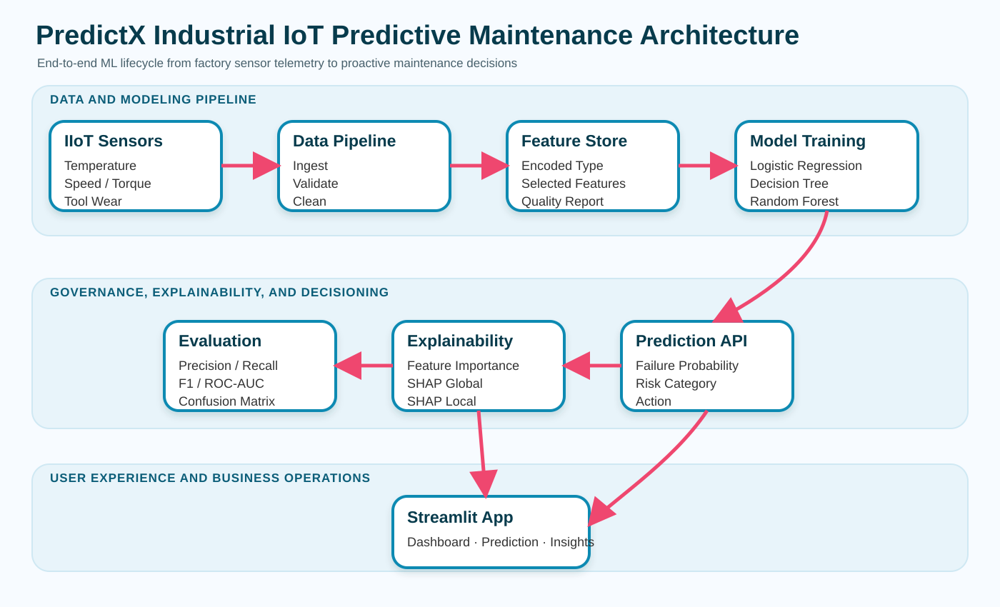

# PredictX — Industrial IoT Predictive Maintenance


PredictX is an end-to-end **predictive-maintenance ML system for industrial equipment**.

It takes machine and sensor telemetry, validates and prepares the data, compares multiple failure-classification models, persists the selected model, exposes single-machine risk scoring, generates explainability artifacts, and presents the results through a multi-page Streamlit application.

The implementation is intentionally modular so the repository can be studied as a complete applied-ML workflow rather than as a single notebook.



---

## Problem

Unexpected equipment failures can cause:

- unplanned downtime
- maintenance cost
- production interruptions
- equipment degradation
- operational uncertainty

PredictX frames predictive maintenance as a binary classification problem:

> **Given the current machine telemetry, estimate the probability of machine failure and translate that prediction into an operational risk level.**

The application turns the model output into:

```text
sensor telemetry
      ↓
validated features
      ↓
failure probability
      ↓
risk category
      ↓
maintenance recommendation
```

---

## What Is Implemented

### Data & preprocessing

- AI4I 2020 dataset ingestion
- deterministic offline fallback dataset for restricted environments
- schema validation
- duplicate removal
- missing-value imputation
- categorical feature encoding
- data-quality reporting
- persisted preprocessing metadata
- reproducible train/test splitting

### Model training

Three classical ML models are trained and compared:

1. Logistic Regression
2. Decision Tree
3. Random Forest

The current model-selection rule prioritizes:

1. F1 score
2. ROC-AUC as the tie-breaker

The selected model is persisted with Joblib.

### Evaluation

The evaluation pipeline reports:

- Accuracy
- Precision
- Recall
- F1
- ROC-AUC
- Confusion matrix
- Classification report

### Prediction

A single-machine prediction accepts:

- machine type
- air temperature
- process temperature
- rotational speed
- torque
- tool wear

The prediction engine returns:

- failure prediction
- failure probability
- risk category
- recommended maintenance action

### Explainability

PredictX includes:

- model-native feature importance
- SHAP-based global explanations when available
- local explanation visualization
- feature-importance fallbacks if SHAP execution fails
- maintenance-oriented interpretation text

### Business layer

The repository also estimates:

- observed failure rate
- failure count
- estimated downtime exposure
- potential cost savings
- high-tool-wear asset rate
- high-torque alert rate

These values are based on configurable business assumptions and should be treated as scenario estimates, not measured operational savings.

---

## Architecture

```text
                         AI4I 2020 / Offline Fallback
                                      |
                                      v
                           Data ingestion + validation
                                      |
                                      v
                         Cleaning + feature encoding
                                      |
                                      v
                           Stratified train / test
                                      |
                     +----------------+----------------+
                     |                |                |
                     v                v                v
               Logistic Reg.    Decision Tree    Random Forest
                     |                |                |
                     +----------------+----------------+
                                      |
                                      v
                            Model comparison
                                      |
                                      v
                              Best-model save
                                      |
                +---------------------+---------------------+
                |                     |                     |
                v                     v                     v
           Evaluation            Explainability        Prediction
                |                     |                     |
                v                     v                     v
         metrics + plots       SHAP / importance     probability
                                                          |
                                                          v
                                                  risk category
                                                          |
                                                          v
                                               maintenance action
                                                          |
                                                          v
                                                Streamlit dashboard
```

---

## Dataset

PredictX is designed around the **AI4I 2020 Predictive Maintenance Dataset**.

### Modeling target

```text
Machine failure
```

### Features used

| Feature | Type |
|---|---|
| Type | Categorical |
| Air temperature [K] | Numeric |
| Process temperature [K] | Numeric |
| Rotational speed [rpm] | Numeric |
| Torque [Nm] | Numeric |
| Tool wear [min] | Numeric |

The source dataset is downloaded from the UCI repository when available.

When network access is unavailable, the preprocessing module creates a deterministic AI4I-like fallback dataset using a fixed seed. This keeps development and tests runnable offline, but **fallback data should not be interpreted as the real AI4I benchmark**.

---

## Preprocessing

The preprocessing pipeline performs:

```text
Raw data
   ↓
Schema validation
   ↓
Quality report
   ↓
Duplicate removal
   ↓
Missing-value handling
   ↓
Categorical encoding
   ↓
Processed dataset
```

The pipeline also persists:

- processed data
- data-quality report
- categorical encoders
- prediction schema

The project uses a fixed random seed of `42` and a `20%` test split.

---

## Model Training

The training registry currently contains:

### Logistic Regression

Configured with:

- `max_iter=1000`
- `class_weight="balanced"`

### Decision Tree

Configured with:

- `max_depth=8`
- `min_samples_leaf=10`
- `class_weight="balanced"`

### Random Forest

Configured with:

- `n_estimators=160`
- `max_depth=12`
- `min_samples_leaf=4`
- `class_weight="balanced_subsample"`
- parallel training with `n_jobs=-1`

All candidate models are trained on the same stratified split and evaluated using the same metrics.

---

## Risk Scoring

The prediction engine converts the model probability into four operational bands:

| Failure probability | Risk |
|---:|---|
| < 0.20 | Low |
| 0.20 – <0.40 | Medium |
| 0.40 – <0.70 | High |
| ≥ 0.70 | Critical |

The application then maps the risk category to a maintenance recommendation.

```text
Critical
→ immediate inspection / stop or derate if appropriate

High
→ schedule maintenance in the next shift

Medium
→ increase monitoring and plan preventive maintenance

Low
→ continue routine condition monitoring
```

These recommendations are decision-support logic, not safety-certified control actions.

---

## Explainability

The explainability layer follows a fallback hierarchy:

```text
Best model
   ↓
Native feature importance
   +
SHAP when available
   ↓
Global explanation
   +
Local explanation
   ↓
Business interpretation
```

For tree-based models, native feature importance is available directly.

When SHAP is available, the project attempts to produce:

- global SHAP summary
- local explanation visualization

If SHAP fails or is unavailable, the project generates fallback plots based on model feature importance so the application remains usable.

---

## Business Insights

PredictX includes a small decision-support layer for maintenance economics.

The current calculation accepts:

- downtime cost per hour
- average downtime per failure
- preventable failure rate

and estimates:

```text
failure count
        ↓
failure rate
        ↓
downtime exposure
        ↓
potential avoidable savings
```

### Important

These are **scenario calculations**.

For example, the default values of `$7,500/hour`, `6 hours` downtime, and `35%` preventable failures are configurable assumptions. They are not claims about a real factory's measured economics.

---

## Streamlit Application

Launch the application with:

```bash
streamlit run streamlit_app.py
```

The dashboard contains six sections:

### Home
Project overview and platform capabilities.

### Dashboard
- machine count
- failure rate
- failure count
- potential savings
- dataset preview
- EDA refresh
- sensor distributions

### Prediction
Interactive single-machine failure risk scoring.

### Model Comparison
- model metrics table
- metric comparison chart
- optional retraining
- comparison plot export

### Explainability
- feature importance
- explanation generation
- SHAP/fallback visualizations
- business interpretation of important features

### Business Insights
Interactive assumptions for:
- downtime cost
- downtime duration
- preventable failure rate

---

## Repository Structure

```text
PredictX/
├── app/
│   ├── Home.py
│   ├── Dashboard.py
│   ├── Prediction.py
│   ├── Model_Comparison.py
│   ├── Explainability.py
│   └── Business_Insights.py
│
├── src/
│   ├── data_preprocessing.py   # ingestion, validation, cleaning, encoding
│   ├── train.py                # model registry, training, selection
│   ├── evaluate.py             # evaluation report + confusion matrix
│   ├── predict.py              # machine-level risk scoring
│   ├── explain.py              # SHAP + fallback explanations
│   ├── feature_importance.py   # model-native feature importance
│   ├── model_comparison.py     # metrics tables and comparison plots
│   ├── business_insights.py    # maintenance economics
│   ├── eda.py                  # EDA artifact generation
│   ├── results_summary.py      # end-to-end pipeline orchestration
│   └── utils.py                # configuration, logging, persistence
│
├── data/
│   ├── raw/
│   └── processed/
├── models/
├── screenshots/
├── notebooks/
│   └── PredictX_EDA.ipynb
├── tests/
│   ├── test_preprocessing.py
│   ├── test_training.py
│   └── test_prediction.py
├── architecture.svg
├── streamlit_app.py
├── requirements.txt
├── pytest.ini
├── LICENSE
└── README.md
```

---

## Quick Start

### 1. Clone

```bash
git clone https://github.com/chamanvashishth/PredictX.git
cd PredictX
```

### 2. Create an environment

```bash
python -m venv .venv
```

Activate the environment, then:

```bash
pip install -r requirements.txt
```

### 3. Run the full pipeline

```bash
python -m src.results_summary
```

This orchestrates:
- preprocessing
- training
- evaluation
- EDA
- model comparison
- explainability
- business insights

### 4. Run individual stages

```bash
python -m src.data_preprocessing
python -m src.eda
python -m src.train
python -m src.evaluate
python -m src.explain
```

### 5. Launch the dashboard

```bash
streamlit run streamlit_app.py
```

---

## Testing

Run:

```bash
pytest -q
```

The test suite covers:
- preprocessing and cleaning
- feature encoding
- processed-data export
- model training and artifact persistence
- risk-category thresholds
- end-to-end prediction output

---

## Generated Artifacts

### `data/processed/`
- processed dataset
- data-quality report

### `models/`
- best model
- model metrics
- preprocessing artifact
- prediction schema
- evaluation report

### `screenshots/`
- histograms
- correlation heatmap
- failure distribution
- boxplots
- feature correlation analysis
- model comparison
- feature importance
- SHAP/global explanation
- SHAP/local explanation
- confusion matrix

---

## Engineering Characteristics

### Reproducibility
- fixed random seed
- deterministic fallback data
- persisted model/preprocessing artifacts
- explicit configuration

### Modularity
Data, training, evaluation, explainability, prediction, business logic, and UI are separated into dedicated modules.

### Robustness
The project can still execute in restricted environments because dataset ingestion has an offline fallback and explainability has a fallback path.

### Testability
Core preprocessing, training, and prediction workflows have unit tests.

### Decision orientation
The prediction layer exposes a risk category and maintenance action instead of returning only a raw class label.

---

## Limitations

PredictX is an applied ML project and a prototype for predictive-maintenance workflows. It is **not a production industrial control system**.

Current limitations include:

- offline fallback data is synthetic and should not be used for real benchmarking
- no streaming telemetry ingestion
- no online model monitoring
- no drift detection
- no model calibration workflow
- no experiment tracking
- no feature store
- no REST inference service
- no remaining-useful-life model
- no failure-mode multi-class modeling
- no distributed training
- no industrial safety certification

---

## Future Work

Natural extensions include:

1. MQTT/Kafka/AWS IoT ingestion
2. batch and REST inference service
3. model registry and experiment tracking
4. data/model drift monitoring
5. probability calibration
6. remaining useful life estimation
7. failure-mode classification
8. time-aware features
9. containerized deployment
10. automated retraining and CI/CD
11. online feature storage
12. industrial telemetry integration

---

## Technical Stack

**Language**
- Python

**Data**
- Pandas
- NumPy

**Machine Learning**
- scikit-learn
- Logistic Regression
- Decision Tree
- Random Forest

**Explainability**
- SHAP
- model-native feature importance

**Visualization**
- Matplotlib
- Seaborn

**Application**
- Streamlit

**Persistence**
- Joblib
- JSON
- CSV

**Testing**
- Pytest

---

## License

MIT License. See [LICENSE](LICENSE).

---

## Author

**Chaman Vashishth**

GitHub: [@chamanvashishth](https://github.com/chamanvashishth)
